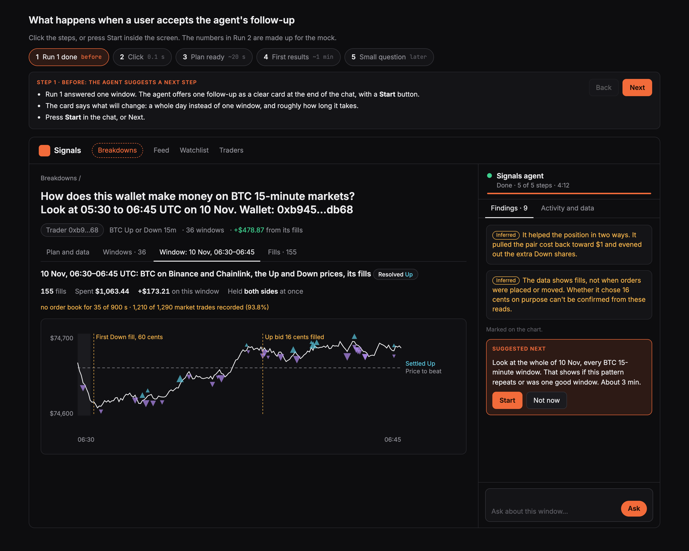
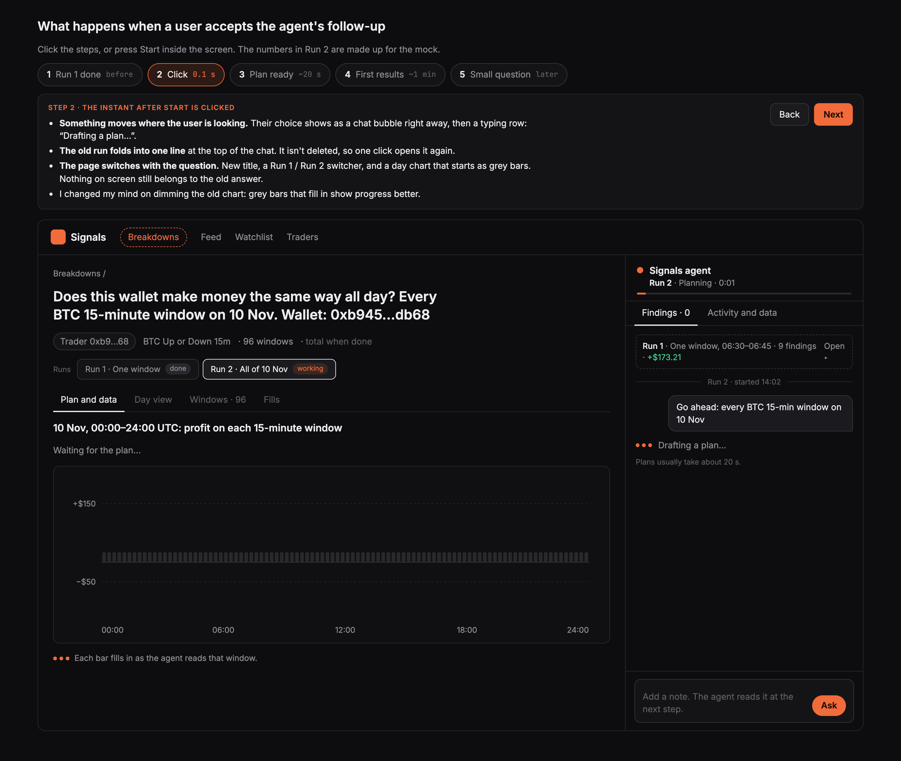
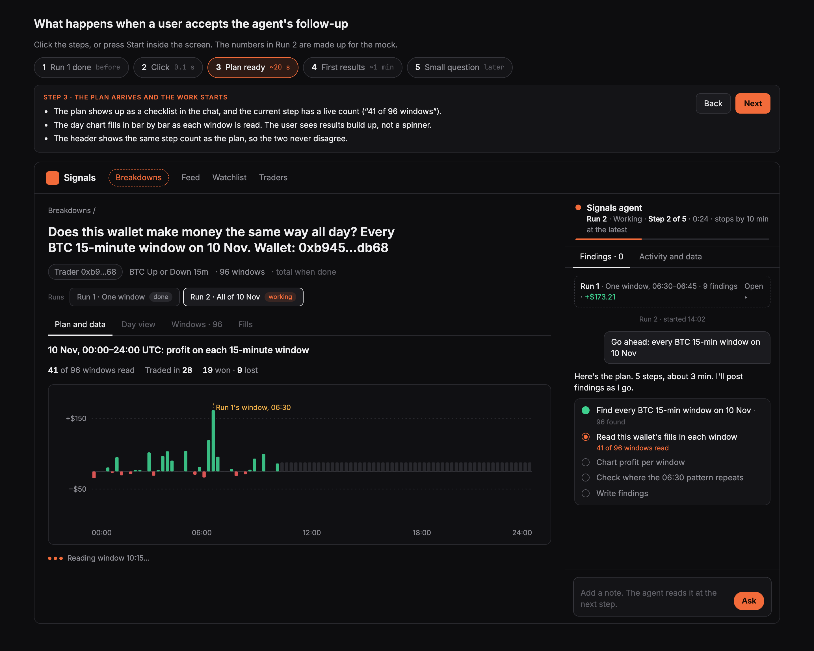
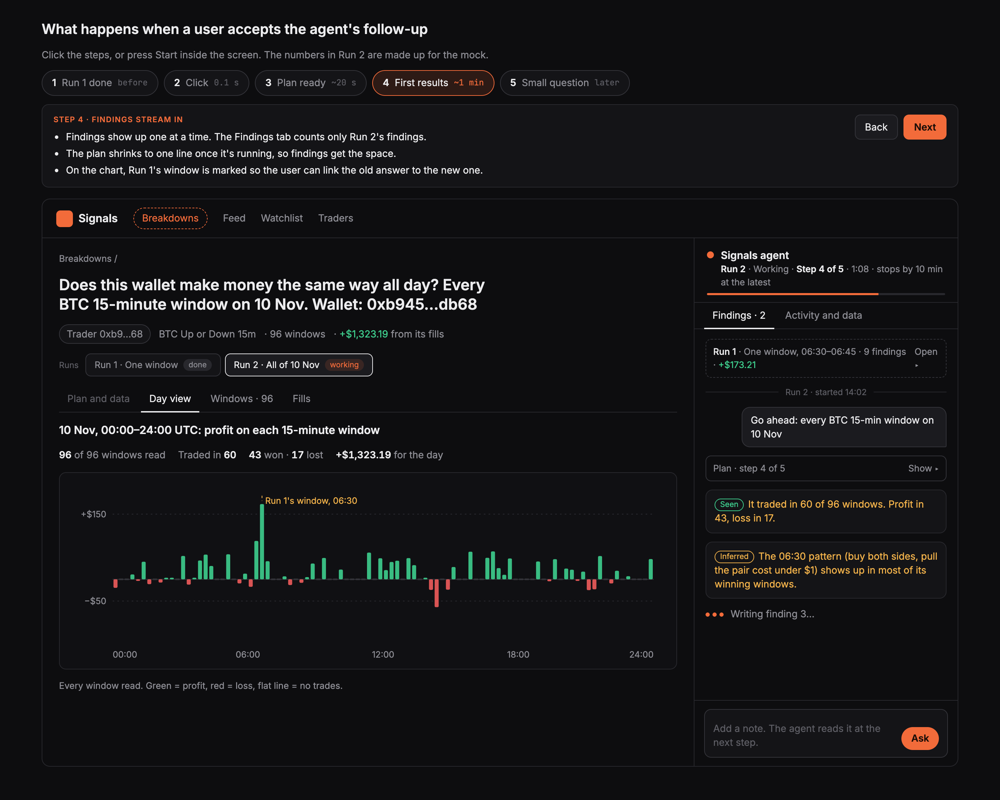
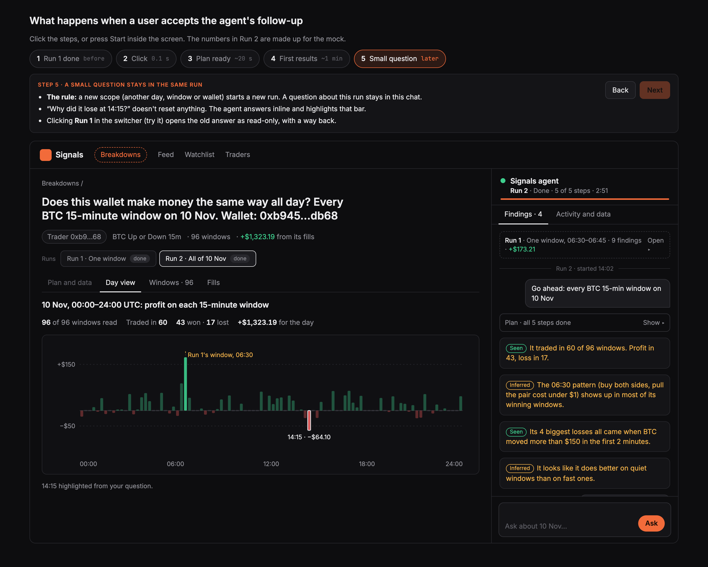
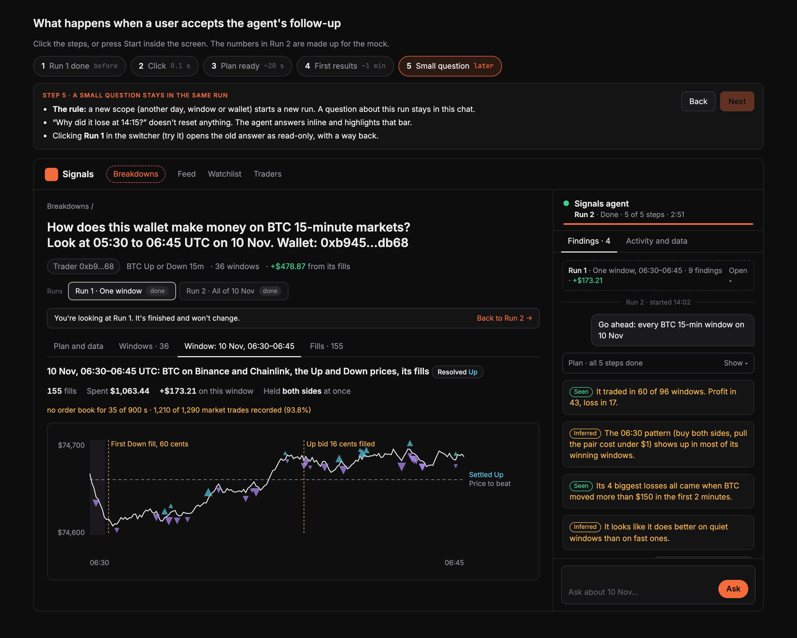

# Breakdowns: when a user accepts the agent's follow-up

Design mock-up only. No app code changes yet.

## The problem today

- After **Start**, the chat shows nothing new for up to a minute. There's no typing row and no "planning" line where the user is looking.
- The old run's findings stay in the chat, mixed with the new plan.
- The page keeps the old title, tabs and chart, so the user can't tell old from new.
- The echoed message reads "You asked: Yes: Yes, go ahead: Next, I'd look…".

## The proposal

- **Feedback within a split second.** The user's choice shows as a short chat bubble straight away, followed by "Drafting a plan…" with typing dots.
- **A new scope starts a new run.** Run 1 folds into one line at the top of the chat (it stays one click away), and the Findings tab counts only the current run.
- **The page changes with the question.** New title, a Run 1 / Run 2 switcher, and a day chart that starts as grey bars and fills in as each window is read.
- **Small questions stay in the same run.** "Why did it lose at 14:15?" is answered inline. Only a new day, window or wallet starts a new run.

## Screens

The numbers in Run 2 are made up for the mock.

| Step | Screen |
|---|---|
| 1. Run 1 done, agent suggests a next step |  |
| 2. 0.1 s after Start: bubble, typing row, Run 1 folded, grey bars |  |
| 3. ~20 s: plan as a checklist, chart filling in |  |
| 4. ~1 min: findings stream in, Run 1's window marked |  |
| 5. A small question stays in Run 2 |  |
| Run 1 reopened from the switcher (read-only) |  |

Clickable version: open `mock.html` in a browser.
